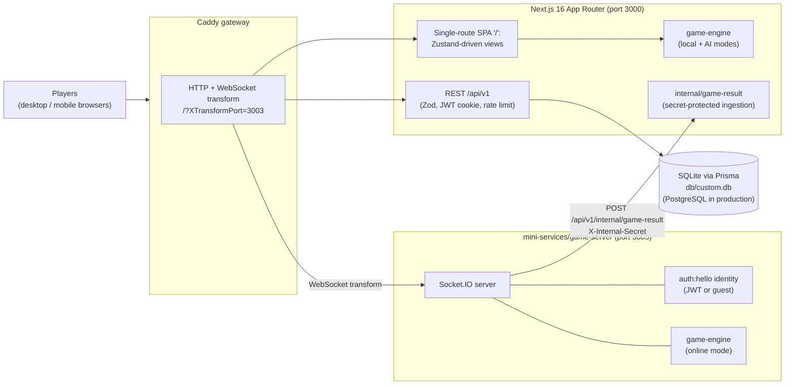
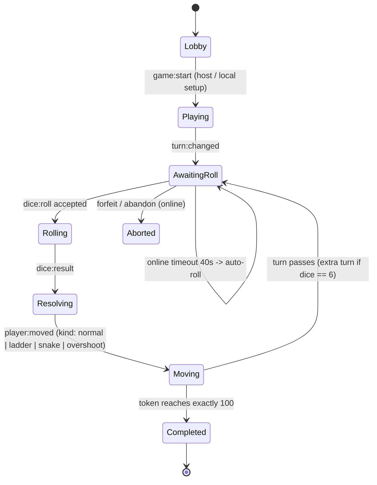
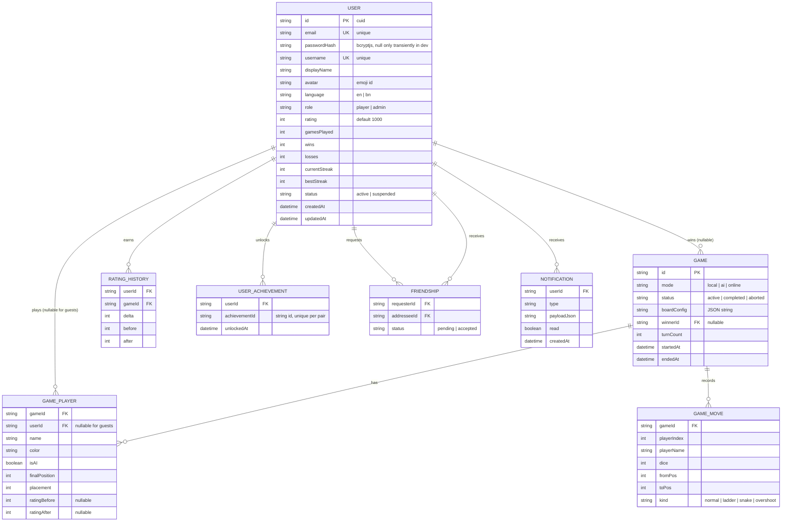

# SAPLUDU Architecture

| Field | Value |
| --- | --- |
| Version | 0.1.0 |
| Date | 2026-01-14 |
| Scope | System architecture, modules, protocols, data model, security, scaling path |

---

## 1. Principles

1. **One engine, two hosts.** A single pure TypeScript game engine (`src/lib/game-engine/`) is imported by the Next.js app (local/AI modes) and by the Socket.IO server (online mode). Rules cannot diverge between modes.
2. **Server authority online.** The client renders; the Socket.IO server decides. Dice (`crypto.randomInt(1,7)`), moves, turns, timeouts, and completion are server-computed.
3. **Single visible route.** Only `/` is user-visible. Views (Landing, Auth, Dashboard, PlaySetup, Online, Game, Profile, Leaderboard, Friends, Settings, Rules, Admin) switch via the Zustand `ui` store.
4. **Honest boundaries.** SQLite in the sandbox, PostgreSQL in production; documented deviations with upgrade paths (MASTER_SPECIFICATION.md §2).

---

## 2. Context Diagram



Notes:
- In the development sandbox the web app runs at `localhost:3000` and the game server at `localhost:3003`; the client always connects same-origin with `io('/?XTransformPort=3003')`, never hardcoding a host.
- The game server is the only writer of authoritative online game state; it never queries the database directly for game results — it delegates ingestion to the Next.js internal endpoint so all persistence goes through one Prisma layer.

---

## 3. Game-State Flow

The same state machine applies everywhere: in local/AI modes it runs inside the client's `game` store driven by the shared engine; in online mode it runs on the Socket.IO server and is mirrored to clients as events.



Move kinds and their resolution:
- `normal` — plain advance p → p + dice.
- `ladder` — destination is a ladder foot; token climbs (`path[]` includes the climb).
- `snake` — destination is a snake head; token slides down.
- `overshoot` — p + dice > 100; token stays (exact-finish rule).

---

## 4. Online Sequence — Dice Roll and Reconnection

### 4.1 A server-authoritative dice roll

```mermaid
sequenceDiagram
    autonumber
    participant C as Client (view: Game)
    participant S as Game Server :3003
    participant E as Shared Engine
    participant N as Next.js internal/game-result
    participant DB as Prisma (SQLite/Postgres)

    Note over C,S: socket = io('/?XTransformPort=3003'); auth:hello {token | guest:{name}}
    S-->>C: room:state
    C->>S: dice:roll
    S->>S: validate turn ownership + idempotency (state.version)
    alt not your turn or duplicate roll
        S-->>C: error { code, message }
    else valid
        S->>S: dice = crypto.randomInt(1, 7)
        S->>E: applyRoll(state, playerIndex, dice)
        E-->>S: new state + move events (path[], kind)
        S-->>C: dice:result { playerIndex, dice }
        S-->>C: player:moved { playerIndex, from, to, path[], kind }
        alt dice < 6
            S-->>C: turn:changed { playerIndex, reason }
        else dice == 6
            Note over S: same player rolls again (one extra turn)
        end
        alt token reaches exactly 100
            S-->>C: game:completed { winnerIndex, results }
            S->>N: POST result (X-Internal-Secret)
            N->>DB: transaction: stats, Elo (K=32) + RatingHistory, achievements, notifications
        end
    end
```

### 4.2 Disconnect and reconnect (90 s grace)

```mermaid
sequenceDiagram
    autonumber
    participant C as Reconnecting Client
    participant S as Game Server
    participant O as Other Clients

    C--xS: connection lost mid-game
    S-->>O: player:disconnected
    Note over S: 90 s reconnection grace timer starts;<br/>turn timeout (40 s) may auto-roll meanwhile
    alt client returns within 90 s
        C->>S: auth:hello { token }
        S->>S: match identity to room slot
        S-->>C: game:state_sync { state (version) }
        S-->>O: player:reconnected
    else 90 s elapses
        Note over S: slot abandoned -> forfeit handling,<br/>game:completed with updated placements
    end
```

---

## 5. Module Descriptions

| Module | Location | Responsibility |
| --- | --- | --- |
| Game engine | `src/lib/game-engine/` | Pure rules: board config, `applyRoll`, move kinds, win detection, state versioning. No I/O, no randomness (dice is an input). |
| i18n | `src/lib/i18n/` (+ Zustand store) | Lightweight EN/BN dictionary; persisted language choice; equivalent of i18next. |
| Auth lib | `src/lib/auth/` | bcryptjs hashing, jose JWT sign/verify, httpOnly cookie helpers, session lookup. |
| Elo | `src/lib/elo/` | K=32 rating math, pair updates, applied only to online human-vs-human matches. |
| Achievements | `src/lib/achievements/` | Catalog of 7 bilingual achievements, unlock evaluation from ingested results. |
| Sound | `src/lib/sound/` | Web Audio API synthesized SFX (dice, move, ladder, snake, win, turn). No binary assets. |
| Socket client | `src/lib/socket-client/` | `io('/?XTransformPort=3003')` wrapper, event typing, reconnect + `game:state_sync` handling. |
| Rate limit | `src/lib/rate-limit/` | In-memory limiter for auth routes (single-node scope; Redis in production). |
| DB | `src/lib/db.ts` | Prisma client singleton. |
| UI stores | `src/stores/` | `ui` (view switching), `auth` (session mirror), `game` (local/AI state), `online` (rooms/socket state). |
| Board components | `src/components/board/` | 10x10 grid, boustrophedon numbering, snake/ladder rendering, token offset stacking. |
| Game components | `src/components/game/` | Dice, turn indicator, player panels, dice history, result screens. |
| View components | `src/components/views/` | Landing, Auth, Dashboard, PlaySetup, Online, Game, Profile, Leaderboard, Friends, Settings, Rules, Admin. |
| Game server | `mini-services/game-server/index.ts` | Socket.IO authoritative service (rooms, matchmaking, game loop, timeouts, reconnection, ingestion POST). |
| Schema | `prisma/schema.prisma` | Data model (SQLite in sandbox; PostgreSQL-ready provider swap). |

---

## 6. Folder Structure

```
/home/z/my-project
├── src/
│   ├── app/
│   │   ├── page.tsx                  # the only user-visible route: view router
│   │   ├── layout.tsx
│   │   └── api/v1/                   # REST surface (auth, users, leaderboard,
│   │                                 #   achievements, friends, games, admin,
│   │                                 #   internal/game-result)
│   ├── lib/
│   │   ├── game-engine/              # shared pure engine
│   │   ├── i18n/ auth/ elo/ achievements/ sound/
│   │   ├── socket-client/ rate-limit/ db.ts
│   ├── stores/                       # ui, auth, game, online, i18n dictionary
│   ├── components/
│   │   ├── board/                    # board rendering
│   │   ├── game/                     # dice, panels, results
│   │   ├── views/                    # the 12 view screens
│   │   └── ui/                       # shadcn/ui primitives
│   └── hooks/
├── mini-services/
│   └── game-server/
│       └── index.ts                  # Socket.IO :3003 authoritative server
├── prisma/
│   └── schema.prisma
├── db/
│   └── custom.db                     # SQLite (sandbox)
├── Caddyfile                         # gateway transform for :3003
├── docs (repo root)
│   ├── MASTER_SPECIFICATION.md  ARCHITECTURE.md  IMPLEMENTATION_PLAN.md
│   ├── PROGRESS.md  CHANGELOG.md  GAME_RULES.md
│   ├── DEPLOYMENT.md  README.md  AGENTS.md
└── package.json                      # bun scripts (dev, lint, db:push, ...)
```

---

## 7. Socket Contract Tables

Connection: `io('/?XTransformPort=3003')`, same-origin via gateway. Identity is established by the first `auth:hello` message (registered JWT or guest name). State carries a monotonically increasing `version`; duplicate `dice:roll` within one turn is rejected.

### Client → Server

| Event | Payload | Notes |
| --- | --- | --- |
| `auth:hello` | `{ token? , guest?: { name } }` | Required first message |
| `room:create` | `{ maxPlayers }` | Host becomes creator; 6-char code returned |
| `room:join` | `{ code }` | Join by code |
| `room:leave` | `{}` | Voluntary leave |
| `room:ready` | `{ ready }` | Ready toggle |
| `room:color` | `{ color }` | Pick a free color |
| `game:start` | `{}` | Host-only |
| `dice:roll` | `{}` | Turn-owned; idempotent per turn |
| `matchmaking:join` | `{}` | Public queue |
| `matchmaking:cancel` | `{}` | Leave queue |
| `game:forfeit` | `{}` | Abandon active game |

### Server → Client

| Event | Payload | Notes |
| --- | --- | --- |
| `room:state` | room snapshot | Authoritative lobby state |
| `room:player_joined` / `room:player_left` | player info | Lobby changes |
| `room:ready` | `{ playerId, ready }` | Ready toggle broadcast |
| `game:start` | `{ state }` | Initial versioned state |
| `dice:result` | `{ playerIndex, dice }` | Server-rolled value |
| `player:moved` | `{ playerIndex, from, to, path[], kind }` | kind: normal, ladder, snake, overshoot |
| `turn:changed` | `{ playerIndex, reason }` | Includes timeout auto-roll reason |
| `game:completed` | `{ winnerIndex, results }` | Final placements |
| `player:disconnected` / `player:reconnected` | player info | During 90 s grace |
| `game:state_sync` | `{ state }` | Full resync on reconnect |
| `matchmaking:searching` / `matchmaking:matched` | `{}` / `{ code }` | Queue lifecycle |
| `error` | `{ code, message }` | Machine-readable codes |

---

## 8. Data Model (ER)



Modeling rules: guests never create User rows; Elo writes only for online human-vs-human games; result ingestion (stats + Elo + achievements + notifications) is one transaction triggered by the game server via `POST /api/v1/internal/game-result`.

---

## 9. Security Architecture

| Layer | Control |
| --- | --- |
| Passwords | bcryptjs hashing; never stored or logged in plaintext |
| Sessions | JWT signed with `AUTH_SECRET` via jose, delivered in an httpOnly cookie; no token in localStorage |
| Input validation | Zod schemas on every REST body and every socket payload |
| Rate limiting | In-memory limiter on auth routes (register/login) to blunt credential stuffing |
| Dice integrity | Online dice from Node `crypto.randomInt(1,7)` server-side; client cannot influence outcomes; AI never receives biased dice |
| Authority | Turn ownership, room membership, and move legality validated on the server using the shared engine; duplicate rolls rejected by turn-scoped idempotency |
| Internal ingestion | `POST /api/v1/internal/game-result` requires `INTERNAL_SECRET` header; rejected otherwise; never browser-exposed |
| Admin | `role === 'admin'` enforced server-side on all admin endpoints; seeded admin account; suspended users blocked at auth |
| Guests | Guests receive room slots without User rows; no credential material generated for guests |
| Transport | Sandbox runs plain HTTP on localhost; production terminates TLS at Caddy/Nginx (DEPLOYMENT.md) |

Threat notes: because the client computes local/AI dice with `Math.random()`, local results are not tamper-proof — by design those modes never feed Elo or leaderboards, so there is no incentive gradient. All valued outcomes (Elo, leaderboard, achievements tied to online play) originate from server-authoritative ingestion only.

---

## 10. PostgreSQL / Redis Scaling Path

Current sandbox topology is single-node: Next.js (3000) + Socket.IO (3003) + SQLite. Production evolution:

1. **PostgreSQL (Stage 14).** Swap Prisma datasource provider to `postgresql`, provision via Docker Compose, run migrations; JSON fields (`boardConfig`, `payloadJson`) map to `jsonb` if desired. Connection string via `DATABASE_URL`. See DEPLOYMENT.md for the full migration procedure.
2. **Redis.**
   - Rate limiting: replace in-memory limiter with Redis-backed counters (multi-instance safe).
   - Matchmaking queue: move the public queue from memory to Redis for durability and multi-node fairness.
   - Socket.IO adapter: `@socket.io/redis-adapter` allows horizontal scaling of game servers; requires sticky sessions at the gateway (WebSocket upgrade affinity by room).
   - Presence/timeouts: turn-timeout timers and disconnect grace windows become Redis TTL keys, making them survive server restarts.
3. **Stateless web tier.** Next.js remains stateless (JWT cookie auth) and scales behind the gateway; the game server tier scales only with the Redis adapter in place.
4. **Observability.** Centralize logs from both services; add health endpoints to gateway checks; alert on ingestion failures (result POST non-2xx) to catch lost rated games.
